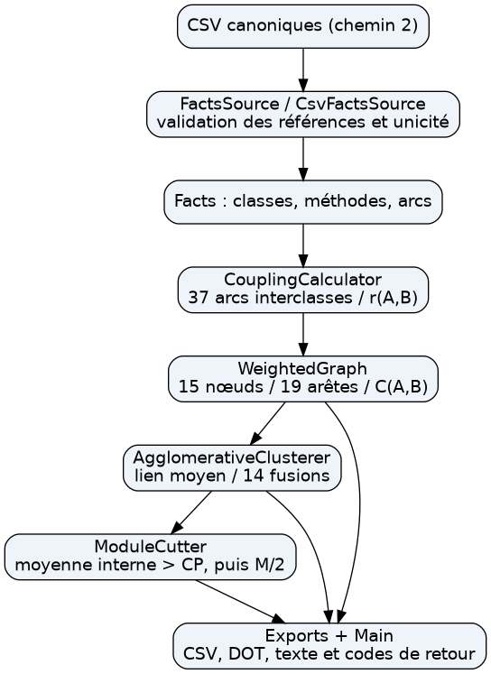
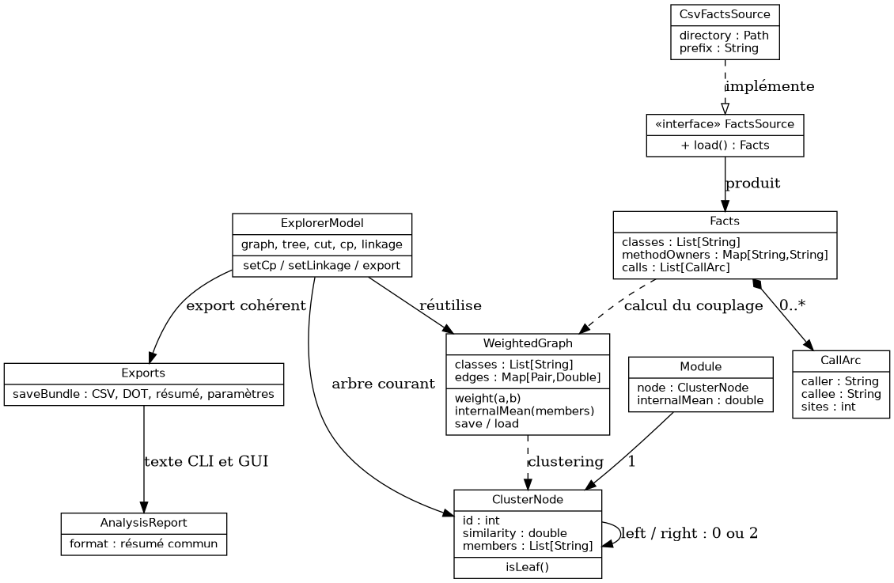
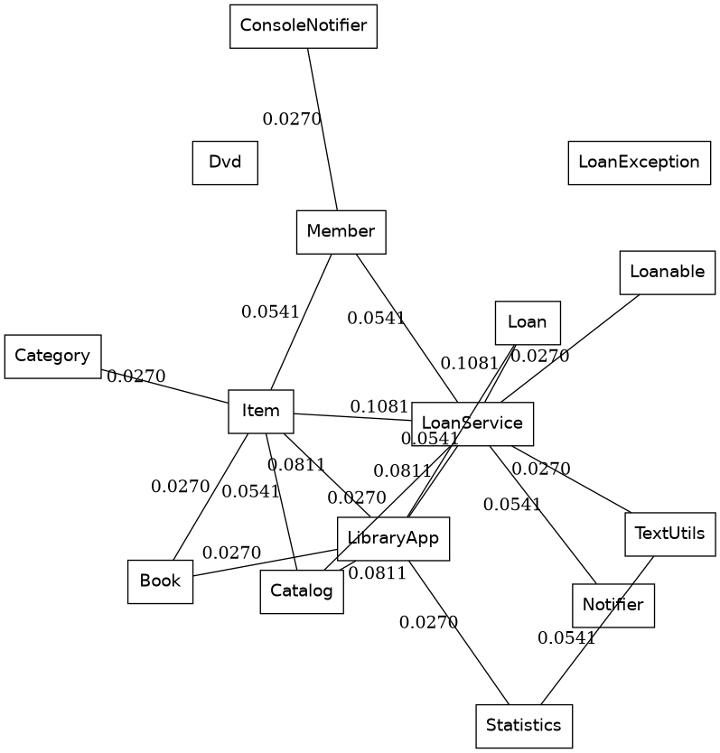
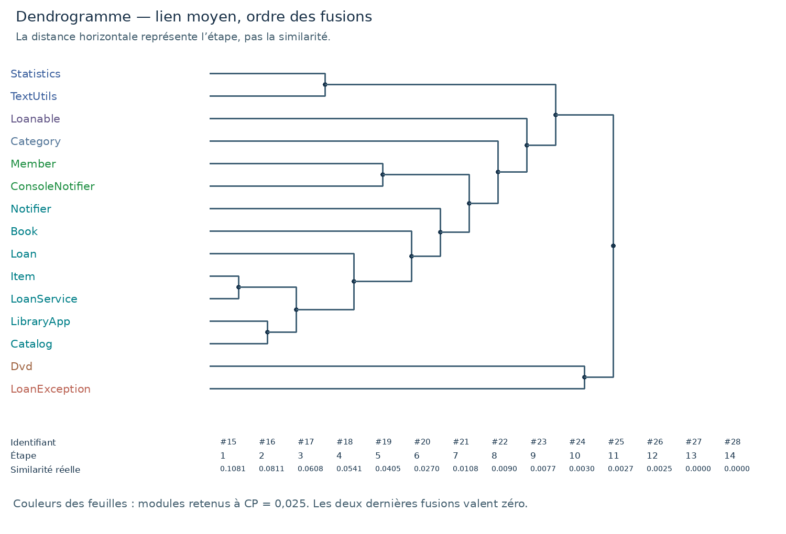
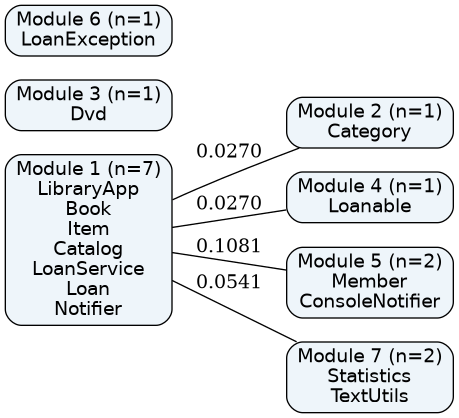
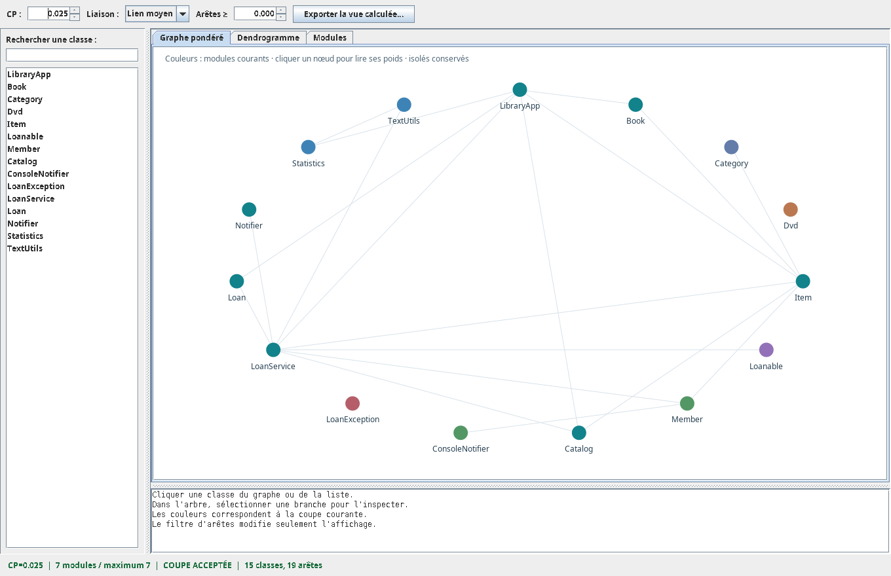

# Note de migration vers le dépôt TP1 + TP2

Ce document décrit le rendu TP2 validé le 16 octobre 2026. Le dépôt a ensuite intégré son moteur au projet TP1 le 17 octobre : les sources sont réunies sous src/, le seul JAR devient target/hai913i-tp1-analyzer.jar et la commande tp2 --sources relie directement les faits du TP1 au moteur. Les résultats et la vidéo du rendu initial restent conservés comme preuves de cette version. Le README principal et doc/INTEGRATION-TP2.md donnent les commandes actuelles et distinguent les validations antérieures de la compilation de l'intégration. Les chemins source/ ou bonus/ cités dans le texte historique correspondent à l'ancien paquet autonome.

# 1. Objectifs et périmètre

Ce TP transforme des faits de programme en une proposition de découpage en modules. L'outil Java charge des classes, des méthodes et des arcs d'appel ; calcule un couplage normalisé entre classes ; construit un graphe non orienté ; applique un clustering hiérarchique ascendant par lien moyen ; puis coupe l'arbre selon un seuil explicite CP et vérifie la limite de M/2 modules [1].

Le livrable couvre les parties obligatoires A et B. Le résultat est une structure de modules issue d'une mesure choisie. Il n'établit ni interfaces de composants déployables, ni frontières de microservices. Les quatre bonus C1 à C4 sont également réalisés et comparés en section 7.

Le chemin d'entrée retenu est le chemin 2 : les faits canoniques fournis. Le rendu du TP1 a été consulté pour reprendre l'identité du binôme et comprendre le modèle précédent. La chaîne obligatoire ne relit pas les fichiers Java. Pour C4, un pont séparé réutilise réellement l'extracteur JDT du TP1 pour reconstruire les faits d'un second projet, puis les fournit au même chargeur CSV. Ce choix isole le problème de regroupement de celui de l'extraction et permet une validation sur un jeu dont les compteurs sont connus.

# 2. Conception générale

## 2.1. Frontière d'entrée et responsabilités

FactsSource est l'unique interface d'entrée : sa méthode load() produit un Facts immuable. CsvFactsSource réalise le chemin 2. Le pont bonus/ExportTp2.java adapte les objets ProjectFacts et CallGraph du TP1 au format canonique. Cette séparation par sérialisation conserve l'indépendance du moteur TP2 : JDT reste dans un projet Maven optionnel, tandis que CsvFactsSource reste le seul chargeur du moteur.

Le modèle Facts contient une liste de noms qualifiés, une table identifiant de méthode vers classe propriétaire et une liste d'arcs. Le chargeur vérifie les en-têtes, l'unicité des classes et méthodes, l'existence des propriétaires, les références des arcs et le caractère positif du nombre de sites. Un arc dupliqué est rejeté plutôt que compté deux fois. Les classes sont triées indépendamment de l'ordre d'entrée.

CouplingCalculator agrège les arcs. WeightedGraph conserve tous les nœuds et seulement les poids non nuls ; weight(a,b) vaut zéro pour une paire absente et sur la diagonale. AgglomerativeClusterer ne voit que ce graphe. ModuleCutter reçoit l'arbre et le graphe. Exports écrit les résultats. Main assemble ces services et traite les arguments et les erreurs. Les faits ne traversent donc pas la frontière du calcul de couplage.



## 2.2. Modèle de données

Les objets sont immuables. Un ClusterNode porte un identifiant, deux fils ou aucun, une similarité de fusion et ses membres triés. Sa construction vérifie que les membres sont exactement l'union disjointe des fils. Module désigne une branche retenue avec sa moyenne interne. Le nombre maximal de modules appartient au résultat de coupe, avec l'indicateur accepted.



Les figures utilisent des noms courts pour rester lisibles. Les fichiers CSV et l'arbre texte gardent les noms qualifiés ; notamment Loan désigne library.service.LoanService.Loan. Dans les faits fournis, son champ package vaut library.service.LoanService : il s'agit d'une convention du fichier pour le type imbriqué. Pour la comparaison architecturale, Loan est rattaché au paquetage Java library.service, comme le demande le sujet.

# 3. Conventions permettant de rejouer les résultats

## 3.1. Appels et couplage

Dans la chaîne obligatoire, la seule relation comptée est l'appel de méthode. Les arcs de constructeurs, l'héritage, les interfaces, les types d'attributs et de paramètres, les instanciations et les exceptions ne sont pas ajoutés. Un arc est un couple orienté (méthode appelante, méthode appelée), unique dans les faits. Le champ sites est validé mais n'est jamais utilisé comme multiplicateur.

Pour A différent de B, r(A,B) compte les arcs reliant les deux classes dans les deux sens. Einter contient tous les arcs entre classes différentes. C(A,B) = r(A,B) / |Einter|. C(A,A) = 0 ; C est symétrique. La somme sur les couples NON ORDONNÉS vaut 1 lorsque Einter est non vide ; sommer toute la matrice compterait chaque arête deux fois et donnerait 2.

Sur le projet canonique, |Einter| = 37 et non 38 (sites interclasses), ni 44 (tous les arcs). Une convention explicite traite le cas sans appel interclasse : tous les couplages sont nuls, leur somme vaut zéro et un diagnostic l'indique. Il n'y a alors aucune division par zéro. Un jeu sans classe est rejeté.

## 3.2. Lien moyen et départage

Pour deux groupes disjoints G1 et G2, S(G1,G2) est la somme de C(a,b) pour a dans G1 et b dans G2, divisée par |G1| × |G2|. Les couples nuls font partie du dénominateur. Le programme recalcule cette valeur directement depuis les couplages entre classes après chaque fusion, pour tous les couples actifs. Il privilégie ainsi la lisibilité de la formule à une mise à jour incrémentale [2].

L'extrait suivant est celui du calcul dans AgglomerativeClusterer.similarity (branche average). La division inclut tous les couples, même ceux dont weight renvoie zéro :

```java
double sum = 0;
for (String x : a.members()) for (String y : b.members())
    sum += graph.weight(x, y);
return sum / ((double) a.members().size() * b.members().size());
```

Les feuilles sont numérotées de 0 à M−1 dans l'ordre lexicographique des noms qualifiés Java. Les nœuds de fusion reçoivent M, M+1, etc. Chaque paire est orientée du plus petit identifiant vers le plus grand. Le programme détermine d'abord le vrai maximum, puis retient le premier couple lexicographique situé à au plus 10⁻⁹ de ce maximum. La comparaison en deux passes empêche une succession de quasi-égalités de faire dériver le maximum de référence.

Dans cluster, les candidats sont produits par identifiants croissants. Après une première passe qui calcule maximum, le premier candidat dans la tolérance est choisi :

```java
for (Candidate c : candidates) {
    if (maximum - c.similarity() <= EPSILON) {
        best = c;
        break;
    }
}
```

La boucle de fusion retire les deux groupes, crée leur union avec nextId++, puis la réinsère parmi les groupes actifs. Ces extraits relient la formule et le départage à l'implémentation effective de B1.

## 3.3. Coupe et statut

Pour un groupe G de n classes, la moyenne interne Cbar(G) est la somme des couplages sur ses n(n−1)/2 couples non ordonnés, divisée par ce nombre. Une feuille est retenue sans condition de moyenne. Pour un nœud interne, le parcours depuis la racine retient le groupe si et seulement si Cbar(G) > CP, puis s'arrête sur cette branche ; sinon il visite les deux fils. La tolérance de départage des fusions ne s'applique pas à ce seuil strict.

Après le parcours, la coupe est acceptée si son nombre de modules ne dépasse pas floor(M/2). Les modules d'une coupe rejetée sont exportés comme diagnostic avec accepted=false ; le processus renvoie 3. Il ne fusionne pas arbitrairement des modules pour satisfaire le plafond. Le seuil CP est obligatoire en ligne de commande, fini et compris entre 0 et 1. Aucune valeur n'est choisie silencieusement.

# 4. Réalisation et résultats, de A0 à B3

## 4.1. A0 — Charger et contrôler les faits

Le chargeur découvre l'unique préfixe *-classes.csv du dossier. S'il existe plusieurs jeux, --prefix permet de lever l'ambiguïté. Les trois fichiers sont nécessaires : les classes isolées ne peuvent pas être reconstituées depuis les appels. Les méthodes sans appel restent comptées.

Le micro jeu fourni [4] donne 3 classes, 5 méthodes et 4 arcs. Le jeu canonique [3] donne 15 classes, 59 méthodes et 44 arcs. Les tests vérifient ces deux entrées et les erreurs de références, de duplication, d'en-tête et de fichier manquant.

```java
FactsSource source = new CsvFactsSource(input, prefix);
Facts facts = source.load();
CouplingCalculator.Result coupling =
        new CouplingCalculator().compute(facts);
```

## 4.2. A1 — Agréger sans compter les sites

La table methodOwners fournit les deux classes de chaque arc. Sept arcs intraclasses sont écartés. Chaque arc restant ajoute une unité à une Pair normalisée, sans utiliser sites. Il reste 37 arcs interclasses, répartis sur 19 des 105 couples possibles.

```java
if (a.equals(b)) { intra++; continue; }
inter++;
counts.merge(new WeightedGraph.Pair(a, b), 1, Integer::sum);
```

Item–LoanService et LoanService–Loan valent chacun 4/37 = 0,1081081081. LibraryApp–Item, LibraryApp–Catalog et LibraryApp–LoanService valent chacun 3/37 = 0,0810810811. Le programme affiche l'ensemble des couples par poids décroissant, avec un ordre lexicographique secondaire. Leur somme vaut 1,0000000000 ; la diagonale est nulle et la matrice est symétrique.

Le micro jeu rend l'erreur de sites visible : deux arcs A→B, dont l'un contient deux sites, donnent C(A,B)=2/3 et non 3/4. C(B,C)=1/3, C(A,C)=0 ; l'arc interne A→A est exclu du dénominateur.

## 4.3. A2 — Graphe et rechargement

Le graphe contient 15 nœuds et 19 arêtes non orientées. Dvd et LoanException sont explicitement présents malgré leur degré nul. graphe.csv sérialise séparément les nœuds et les arêtes ; graphe.dot offre une représentation Graphviz. couplages.csv contient la matrice complète, utile pour contrôler les zéros.

L'option --graph recharge notre graphe CSV et peut rejouer regroupement et coupe. Elle ne dispose plus des faits et n'invente donc aucun compteur de méthodes ni d'arcs. Les poids utilisent Double.toString pour préserver leur valeur au rechargement. Le test de retour aller-retour vérifie les classes, les arêtes, les poids et les isolés ; le protocole compare aussi les modules après rechargement.



## 4.4. B1 — Construire les fusions

Les groupes actifs sont rangés dans une TreeMap par identifiant. À chaque tour, les candidats sont parcourus dans l'ordre lexicographique, leurs similarités sont calculées, puis le couple retenu est remplacé par son union. Le traitement se termine à un seul groupe, y compris si les derniers rapprochements valent zéro.

Sur le micro jeu, A et B fusionnent à 2/3. La fusion suivante avec C vaut (0 + 1/3)/2 = 1/6 : le zéro entre A et C divise bien la similarité par deux. La moyenne interne de la racine vaut pourtant 1/3 ; elle ne se confond pas avec cette dernière similarité de fusion.

Sur le jeu canonique, les trois premières fusions sont Item–LoanService à 4/37 ; LibraryApp–Catalog à 3/37 ; puis ces deux groupes à 9/148 = 0,0608108108. Cette troisième valeur vient des quatre numérateurs 3, 3, 2 et 1, divisés par 4 × 37. Les quatorze fusions sont données dans le tableau ci-dessous et dans fusions.csv.

{{FUSIONS}}

Le test rejoue l'évolution des groupes actifs : à chaque étape, ils partitionnent exactement les 15 classes. Les similarités ne remontent pas et les deux dernières valent zéro. Une seconde exécution fournit les mêmes objets ; le script de validation compare aussi les fichiers octet par octet.

## 4.5. B2 — Restituer l'arbre

L'arbre compte 15 feuilles et 14 nœuds internes, donc 29 groupes en tout. Chaque fusion conserve ses fils, ses membres et sa similarité. Les formats livrés sont l'arbre indenté, la liste CSV des fusions et le DOT. La figure suivante place horizontalement l'ordre des fusions ; les similarités réelles figurent dans le tableau sous l'arbre. Elle évite d'écraser les petites similarités sur une échelle proportionnelle [2].



Les nœuds #27 et #28 illustrent le sens des fusions à zéro. Dvd et LoanException fusionnent entre eux, puis leur groupe rejoint le reste du système : la construction doit aller à une racine unique. Cela ne crée pas de dépendance entre ces classes. Pour les seuils étudiés, ce groupe de moyenne nulle est ensuite séparé par la coupe.

## 4.6. B3 — Retenir des branches et vérifier le plafond

La coupe descend depuis la racine. La décision porte sur la moyenne interne, recalculée sur tous les couples de membres ; aucune classe n'est déplacée entre branches. Le test vérifie la partition, l'appartenance de chaque module à l'arbre et la condition stricte de chaque groupe non singleton.

```java
if (node.isLeaf() || mean > cp)
    modules.add(new Module(node, mean));
else {
    visit(node.left(), graph, cp, modules);
    visit(node.right(), graph, cp, modules);
}
```

{{SEUILS}}

À CP=0,025, le module principal est le nœud #22. Sa moyenne interne vaut 26/(21 × 37) = 0,0334620335, alors que sa similarité de fusion vaut 0,0090090090. Comparer cette dernière à CP aurait refusé à tort le module. Les quatre feuilles sont des modules valides individuellement : leur moyenne est indiquée NA, jamais assimilée à une mesure de cohésion nulle.

{{MODULES}}

# 5. Validation et reproductibilité

La commande scripts/valider.sh construit le projet, exécute les tests, vérifie les codes des coupes attendues, compare les exports de deux exécutions puis recharge le graphe. Le journal est fourni dans sorties/validation.log. Le projet se construit également depuis une copie fraîche de ses sources et données, sans IDE.

{{CONTROLES}}

Les 24 tests JUnit sont tous passés, sans erreur ni test ignoré. Ils couvrent les valeurs calculables à la main, les compteurs canoniques, les invariants de l'arbre et des partitions actives, les seuils 0,015/0,025/0,045, l'égalité exacte au seuil, le départage de quasi-égalités, la formule de moyenne pondérée, le rechargement et le déterminisme des exports. Les tests de robustesse couvrent les arguments absents ou invalides, les fichiers incohérents, les doublons, les valeurs NaN et les arêtes vers un nœud absent.

Pour vérifier la pondération, un groupe de deux classes et un singleton sont réunis : S(A∪B,D) doit égaler (2S(A,D)+S(B,D))/3. Cette assertion indépendante protège contre une moyenne non pondérée des anciennes similarités. Les égalités du seuil sont testées séparément : sur le micro jeu, CP=1/3 refuse la racine ; CP=2/3 refuse également le groupe A,B.

Les cas sans appel et à une seule classe sont définis. Sans appel, tout poids est nul ; avec un seuil non négatif, toutes les feuilles restent séparées. À une classe, aucune fusion n'est requise mais le plafond littéral floor(1/2)=0 fait rejeter le module unique. Ces cas ne sont pas maquillés pour produire une acceptation artificielle.


L'audit final est livré dans AUDIT.md. Il consigne les défauts réellement relevés, leurs corrections et les preuves correspondantes. Outre les 24 tests JUnit, scripts/verifier-oracle.py sert d'oracle distinct : il utilise des fractions exactes Python, sans appeler les fonctions Java testées, et compare 112 exécutions, dont 16 systèmes générés à données mélangées. Il couvre les deux liaisons, les couplages, les identifiants et l'ordre des fusions, les membres, les coupes et leurs codes. Les jeux sans appel et les relations structurelles sont inclus. La trace synthétique est sorties/oracle-validation.json.

Les nouvelles régressions reproduisent l'export graphique au résumé périmé, le diagnostic faux d'un graphe sans appel mais avec héritage, le rechargement non normalisé, les noms ambigus et les arbres/groupes invalides. L'oracle ne prouve pas tous les comportements possibles ; il apporte une vérification indépendante sur davantage de cas que les seuls exemples du sujet.

# 6. Interprétation et regard critique — B4

## 6.1. Modules et paquetages

Le module Statistics–TextUtils coïncide avec library.util et reste stable aux trois seuils. Il existe un lien d'appel de deux arcs entre ses classes. Les autres paquetages ne sont pas retrouvés comme blocs : le module principal traverse library.app, library.model et library.service ; Member est séparé d'Item alors que tous deux appartiennent au modèle ; Notifier rejoint le module principal, mais ConsoleNotifier rejoint Member.

La comparaison suivante détaille toute la partition retenue à CP=0,025. Loan désigne le type imbriqué de LoanService, rattaché ici au paquetage Java service.

| Module | Classes (noms courts) | Paquetages Java | Interprétation |
| --- | --- | --- | --- |
| 1 | LibraryApp, Book, Item, Catalog, LoanService, Loan, Notifier | app, model, service | Flux métier transversal ; les appels ne reproduisent pas les couches déclarées. |
| 2 | Category | model | Singleton lié au reste, séparé par la coupe ; ce n'est pas un isolé du graphe. |
| 3 | Dvd | model | Singleton isolé : l'héritage n'est pas compté. |
| 4 | Loanable | model | Singleton lié, sans expansion polymorphe des implémentations. |
| 5 | Member, ConsoleNotifier | model, service | Association discutable entre entité et affichage, provoquée par un getter. |
| 6 | LoanException | service | Singleton isolé : construction et levée d'exception sont exclues. |
| 7 | Statistics, TextUtils | util | Coïncidence exacte avec le paquetage util et collaboration utilitaire identifiable. |

Le paquetage exprime une organisation déclarée du code. La partition calculée exprime des interactions d'appel avec une normalisation et une moyenne données. Le mélange de l'orchestration LibraryApp et du domaine Item signale des échanges fréquents, mais ne prouve pas une érosion architecturale. Les paquetages peuvent légitimement séparer modèle et services, alors qu'un parcours métier les fait collaborer.



La figure agrège seulement les arêtes du graphe initial. Un poids entre deux modules est la somme des C(A,B) traversant leur frontière ; il ne remplace ni le lien moyen utilisé pendant le clustering, ni la moyenne interne utilisée pendant la coupe. Aucun rôle de composant déployable n'est attribué automatiquement à ces modules.

## 6.2. Classes isolées et interface

Dvd hérite d'Item mais cet héritage ne compte pas. Ses méthodes propres et son constructeur ne créent aucun arc retenu entre classes. LoanException est construite et levée, ce qui n'entre pas non plus dans la relation imposée. Leur absence d'arête résulte de la définition de dépendance, pas d'un échec du clustering. Ce sont des singletons aux trois seuils choisis.

ConsoleNotifier implémente Notifier, mais l'implémentation ne crée pas d'arête et les appels du service sont rattachés à l'interface Notifier. Il n'y a pas d'expansion polymorphe vers toutes les implémentations. Ainsi ConsoleNotifier n'est pas relié au service par cette mesure ; son seul lien retenu est son appel à Member.getName(). Il faut distinguer ce manque de visibilité d'une absence réelle de responsabilité métier.

## 6.3. Un module discutable : Member–ConsoleNotifier

À l'étape 6, les feuilles #6 et #8 fusionnent à 1/37 = 0,0270270270. L'appel de ConsoleNotifier.send vers Member.getName crée un lien unique mais suffit au lien moyen entre deux singletons. Le groupe est ensuite retenu à CP=0,025 puisque sa moyenne interne dépasse ce seuil.

Ce module rassemble une entité du domaine et un mécanisme d'affichage. Il n'a pas de responsabilité architecturale évidente ; le découpage ne doit donc pas être adopté mécaniquement. Quatre autres arcs relient Member à Item et LoanService, deux pour chacun de ces couples. Mais ces classes ont déjà rejoint des groupes plus grands : les zéros et la division par le produit des tailles diluent leur similarité avec Member. Le lien singleton–singleton à 1/37 passe devant ces moyennes. Cette explication relie la composition du module à l'histoire des fusions.

## 6.4. Effet de CP et choix retenu

CP=0,015 satisfait le plafond avec quatre modules, mais l'un contient onze classes. Il mélange presque tout le flux métier, l'orchestration et la notification ; son utilité pour une lecture modulaire est faible. CP=0,045 révèle davantage de petites unités, mais ses dix modules violent le plafond de sept : cette coupe est rejetée.

CP=0,025 est retenu pour ce jeu. Il satisfait tout juste le plafond, préserve la paire utilitaire et réduit le bloc métier à sept classes. Le choix découle d'une comparaison des trois coupes et de leurs tailles. Il ne prétend pas constituer un optimum universel : il conserve notamment la paire discutable Member–ConsoleNotifier et plusieurs singletons.

## 6.5. Limites de la mesure, de la liaison et du seuil

Relation : les faits d'appel ne voient ni héritage, ni implémentation, ni typage structurel, ni instanciation, ni exception, ni fréquence d'exécution. Un arc de getter pèse autant qu'un arc métier. La résolution statique peut masquer un lien à une implémentation. La perte de direction au niveau des classes efface aussi la distinction entre un service fourni et un service requis. Le dénominateur global rend l'échelle de CP dépendante du système analysé.

Liaison : le lien moyen dilue les relations lorsque des groupes grossissent. Les fusions sont gloutonnes et irréversibles : aucune étape ultérieure ne redistribue leurs classes. Le départage impose un résultat reproductible mais n'ajoute pas de justification sémantique à un choix entre ex æquo. Les fusions à zéro terminent l'arbre sans découvrir une responsabilité commune.

Seuil : CP contrôle la granularité et s'applique seulement aux branches de cet arbre. Une petite variation près d'une moyenne interne peut modifier la coupe par paliers. Le plafond M/2 est une contrainte imposée, pas une preuve de qualité architecturale. Un CP fixe ne peut pas être transféré sans examen à un autre projet. La monotonie du nombre de modules avec CP vient du parcours : une branche acceptée plus bas dans l'exigence peut être remplacée par ses descendants lorsque l'exigence augmente.

# 7. Bonus C1 à C4

## 7.1. C1 — Lien simple et première divergence

L'option --linkage single remplace la moyenne des couplages intergroupes par leur maximum. Le défaut reste average. Le départage, les identifiants, l'arbre et la règle de coupe sont identiques ; seul le critère de liaison change. Le test du micro jeu trouve une dernière fusion à 1/3 avec le lien simple, contre 1/6 avec le lien moyen.

Sur le graphe canonique, les deux arbres commencent par Item–LoanService à 4/37. Ils divergent dès l'étape 2. Le lien simple réunit Loan (#11) et le groupe #15 à 4/37 : son meilleur couple est Loan–LoanService. Le lien moyen leur attribue (0 + 4/37)/2 = 2/37, inférieur au 3/37 de LibraryApp–Catalog, qu'il choisit donc à cette étape. La divergence vient du critère, pas d'un autre ordre de départage.

À CP=0,025, les deux coupes donnent sept modules acceptés. Mais le lien simple produit un module principal de huit classes : Member rejoint le noyau et ConsoleNotifier devient singleton. Le lien moyen produit le noyau de sept classes et la paire Member–ConsoleNotifier. Le lien simple facilite l'agrégation par un seul lien fort ; le lien moyen tient compte de tous les liens absents. Ni le nombre identique de modules ni la plus grande taille du noyau ne prouvent une meilleure architecture. Les exports complets sont dans sorties/c1-lien-simple.

## 7.2. C2 — Appels, héritage et implémentation

La variante --inheritance ajoute une unité par relation structurelle dirigée distincte entre types internes, en plus d'une unité par arc de méthode interclasse. Les deux types de relations ont donc ici le même coefficient, explicitement fixé à 1. Pour un couple de classes, le numérateur additionne ses arcs et ses relations structurelles ; le dénominateur additionne tous les arcs interclasses et toutes les relations structurelles internes. La normalisation garde une somme égale à 1 sur les couples non ordonnés.

Le CSV structurel est une conversion reproductible du seul bloc extra.inheritance du JSON fourni ; scripts/heritage.py réalise cette conversion. Ses lignes sont type;target;kind, avec kind égal à extends ou implements. Les doublons et les références de type source inconnues sont rejetés. Les relations vers une bibliothèque sont comptées dans un diagnostic mais ignorées dans le graphe, puisque celui-ci représente les classes du projet.

Quatre relations sont ajoutées : Book→Item, Dvd→Item, Item→Loanable et ConsoleNotifier→Notifier. Trois cibles externes sont ignorées : Enum, Exception et Throwable. Le dénominateur vaut 37+4=41. Le graphe passe de 19 à 22 arêtes ; Book–Item existait déjà et vaut désormais 2/41. Dvd devient reliée à Item ; seule LoanException reste isolée. La relation d'implémentation relie maintenant ConsoleNotifier à Notifier sans développer les appels polymorphes.

| Variante | CP | Modules | Maximum | Statut |
| --- | --- | --- | --- | --- |
| Appels seuls | 0,025 | 7 | 7 | Acceptée |
| Appels + structure | 0,025 | 8 | 7 | Rejetée |
| Appels + structure | 0,020 | 7 | 7 | Acceptée |

À seuil fixe, le changement de dénominateur fait notamment passer Member–ConsoleNotifier de 1/37 à 1/41, sous 0,025 ; cette paire est donc séparée. Au seuil recalibré de 0,020, elle redevient un module. Le noyau enrichi de sept classes contient Loanable à la place de Notifier. Dvd peut rester singleton malgré son nouveau lien : ses rapprochements arrivent tard, avec un groupe déjà grand, et le lien moyen en dilue le poids. Ajouter une relation rend une classe visible sans garantir son rattachement à un module collectif.

La comparaison distingue ainsi deux effets : les arêtes supplémentaires changent l'arbre, et la nouvelle normalisation change l'échelle du seuil. CP=0,020 est retenu pour illustrer une coupe enrichie acceptable, tandis que le résultat à 0,025 reste fourni pour une comparaison à seuil constant. Les sorties sont dans c2-relations-enrichies et c2-cp-0.020.

## 7.3. C3 — Exploration graphique interactive

L'option --gui ouvre une fenêtre Swing sans dépendance supplémentaire. ExplorerModel appelle les mêmes AgglomerativeClusterer et ModuleCutter que la ligne de commande ; ExplorerWindow ne contient aucune seconde implémentation du regroupement. La fenêtre affiche le graphe, un arbre navigable et la liste des modules. La relation est celle du graphe chargé ; une variante enrichie peut être lancée avec les mêmes options CLI.

La recherche filtre les classes par nom qualifié, sans modifier les données. La sélection d'une classe dans la liste ou dans le graphe affiche ses voisins et les poids ; les isolés restent sélectionnables. La sélection d'une branche affiche ses membres, sa taille, sa similarité de fusion et sa moyenne interne, ce qui aide à distinguer ces deux valeurs. Le changement de CP recalcule la coupe et affiche immédiatement son acceptation ou son rejet. Le changement de liaison reconstruit l'arbre et efface les sélections et l'inspection anciennes. La sélection d'une branche et celle d'une classe sont synchronisées pour éviter des indications contradictoires. Enfin, le filtre d'arêtes modifie seulement l'affichage, tandis qu'un bouton exporte le graphe, l'arbre et la coupe courants.



Les interactions sont justifiées par deux besoins : comprendre l'origine d'un module et explorer l'effet des paramètres sans multiplier les commandes. La recherche facilite l'inspection d'une classe isolée ; le changement de CP permet de voir le plafond échouer à 0,045. La disposition circulaire n'encode aucune distance architecturale : les arêtes et les poids portent la mesure.

Les tests JUnit vérifient le modèle graphique sans écran. L'export utilise désormais AnalysisReport et Exports.saveBundle, partagés avec la CLI : il remplace également resultats.txt et conserve la provenance de la relation. Le code de sortie à la fermeture est celui de la coupe courante (0 ou 3), et non celui du lancement initial. Un essai séparé sur une fenêtre réelle vérifie recherche Dvd, sélection, passage à 0,045 et rejet, changement de liaison, sélection de branche et filtre d'arêtes. Le journal est sorties/interface-validation.log ; video/interface-bonus.mp4 est la capture Robot de cette exécution sur X11 virtuel. Le protocole ouvre également le vrai dialogue JFileChooser, approuve le dossier et vérifie les fichiers écrits après changement de CP. Il vérifie les codes de fermeture 0/3 et le diagnostic 2 en mode sans écran.

## 7.4. C4 — Un second système : l'analyseur du TP1

Le second projet est l'analyseur Java du TP1 fourni par le binôme : 29 unités de compilation et 30 types dans des paquetages cli, parse, extract, model, callgraph, metrics, report, spoon et ui. Son code est conservé dans source/bonus/tp1-extracteur, avec son pom.xml et ses ressources. Un manifeste SHA-256 est réellement vérifié par le protocole, y compris l'absence de fichier supplémentaire dans le corpus. Le sujet n'exige pas un projet tiers : ce second système possède un domaine et une structure distincts du projet de bibliothèque.

Le pont bonus/ExportTp2.java appelle réellement ProjectSources, JdtParser, FactExtractor et CallGraphBuilder du TP1, sans réécrire les visiteurs. Il fournit le classpath du JAR TP1 et de ses dépendances à JDT puis sérialise classes, méthodes et arcs uniques, en conservant le nombre de sites comme information. Le moteur TP2 charge ces CSV par son entrée ordinaire. Les versions optionnelles du TP1 sont JDT Core 3.46.0, Spoon 11.5.0 et SLF4J 2.0.18 ; seule l'extraction JDT est exécutée pour C4.

L'extraction obtient 30 classes, 199 méthodes, 267 arcs et 326 sites internes au graphe, sans erreur de compilation ni appel non résolu. Le même pont est exécuté sur la bibliothèque de validation : il retrouve exactement les 15 classes, les 59 méthodes et les 44 arcs canoniques, y compris leurs nombres de sites. scripts/verifier-extraction.py compare ces faits indépendamment de l'ordre des lignes. Le protocole réextrait également le second projet et compare ses trois CSV octet par octet aux fichiers livrés.

| Mesure | Bibliothèque | Analyseur TP1 |
| --- | --- | --- |
| Classes / méthodes / arcs | 15 / 59 / 44 | 30 / 199 / 267 |
| Arcs internes écartés / interclasses | 7 / 37 | 77 / 190 |
| Arêtes de classes / isolés | 19 / 2 | 52 / 4 |
| Nombre de fusions | 14 | 29 |
| CP=0,025 | 7 modules, accepté | 23 modules, rejeté |

| CP, analyseur TP1 | Modules | Maximum | Statut |
| --- | --- | --- | --- |
| 0,003 | 5 | 15 | Acceptée, très grossière |
| 0,005 | 9 | 15 | Acceptée |
| 0,010 | 15 | 15 | Acceptée |
| 0,025 | 23 | 15 | Rejetée |

Le seuil 0,010 est retenu pour une lecture plus fine tout en respectant le plafond. Le plus grand module rassemble douze classes : CallGraph, CallGraphBuilder, MetricsReport, MetricsService, CallFact, FieldFact, MethodFact, ProjectFacts, TypeFact, TextReport, SpoonRawCounts et AnalyzerWindow. Sa moyenne interne vaut 0,0109250399. Il traverse les paquetages du modèle, des métriques, du graphe, des rapports et de l'interface : les appels aux données rapprochent désormais les records de leurs consommateurs. Le module Main–Analyzer–Options regroupe trois classes d'orchestration ; les paires FactExtractor–ParsedFile et JdtParser–ProjectSources traduisent la lecture des unités et des sources. Les autres modules sont des singletons. Comme pour la bibliothèque, cette partition exprime des collaborations, pas une reconstruction exacte des paquetages.

## 7.5. C4 — Correction du biais des méthodes implicites

Le TP1 d'origine ne conserve que les méthodes déclarées. Avant correction, il obtenait 130 méthodes, 146 arcs et 182 sites internes : 144 sites résolus vers des méthodes absentes des nœuds étaient écartés. Le pont complète maintenant les seules cibles internes réellement résolues par JDT mais absentes de ce modèle : 69 méthodes cibles, 121 arcs distincts et 144 sites réintégrés. Le détail cibles-reintegrees.csv attribue 143 sites à des records et un à l'enum Action. Les méthodes implicites jamais appelées ne sont pas inventoriées ; cela ne retire aucun arc observé. Les corps synthétiques, leurs éventuels appels et les constructeurs ne sont pas reconstruits. Cette limite est distincte de la perte corrigée des appels explicitement présents dans les sources.

La complétion appartient au pont ExportTp2 : le corpus et les visiteurs TP1 restent inchangés et leur manifeste reste vérifiable. Chaque cible doit avoir un propriétaire interne existant de genre RECORD ou ENUM ; une autre catégorie manquante provoque une erreur explicite. Les sites sont agrégés par couple appelant–appelé : la mesure TP2 continue de compter les arcs, sans multiplier leur poids par les occurrences.

| Mesure C4 | Avant complétion | Après complétion |
| --- | --- | --- |
| Méthodes / arcs / sites internes | 130 / 146 / 182 | 199 / 267 / 326 |
| Arcs interclasses / arêtes / isolés | 69 / 31 / 9 | 190 / 52 / 4 |
| Modules à CP=0,010 | 15, acceptée | 15, acceptée |
| Modules à CP=0,025 | 24, rejetée | 23, rejetée |

Le nombre inchangé de modules à 0,010 masque une composition différente : les records TypeFact, FieldFact et CallFact ne sont plus isolés et rejoignent leurs consommateurs. Le changement de dénominateur (69 à 190) modifie aussi tous les poids, y compris les relations déjà présentes. L'écart avant/après relève donc de l'extraction, tandis que l'écart entre la bibliothèque et l'analyseur relève également de leurs tailles, domaines et usages différents. À CP=0,025, le rejet persiste : un seuil ne se transfère pas automatiquement entre projets.

Les quatre isolés restants sont UsageException, AstPrinter, TypeKind et Visibility. Leur isolement n'est plus causé par les accesseurs de records exclus ; la relation d'appel conserve ses autres limites, notamment l'absence des constructions et des relations de typage. Le protocole vérifie les 69 cibles, leurs propriétaires et la conservation exacte des 144 sites, réextrait les CSV et compare leur contenu. Le contrôle sur la bibliothèque reste identique aux 15 classes, 59 méthodes et 44 arcs canoniques.

# 8. Difficultés et limites de réalisation

Une erreur de commentaire XML contenant deux tirets consécutifs a été repérée dans le pom.xml d'une version intermédiaire et corrigée. La construction finale est vérifiée après décompression de l'archive, pour contrôler le livrable effectivement remis.

La difficulté centrale est de distinguer trois nombres : arcs et sites, similarité entre fils et moyenne interne d'un groupe, somme sur les couples non ordonnés et somme de la matrice entière. Le micro exemple et les tests d'égalité au seuil rendent ces erreurs observables sans dépendre du seul projet canonique.

L'environnement initial ne lançait aucune commande à cause d'une erreur bwrap. Après changement de configuration, Java 17 était présent, mais Maven et Graphviz manquaient. Ces outils ont été téléchargés dans un répertoire temporaire sans modification du système ; les versions utilisées sont consignées dans le README. Cette difficulté n'a pas entraîné de changement des conventions du TP.

Le format CSV pris en charge est exactement le format simple fourni : aucun champ ne contient de point-virgule ni de saut de ligne. Le chargeur ne lit pas le JSON et n'extrait pas de sources Java. Le mode --graph exige une somme des poids égale à 1 à 10⁻⁹ près si le graphe contient des arêtes ; sans arête, la somme vaut 0. Les champs contenant guillemet, point-virgule, saut de ligne ou séparateur de membres sont refusés pour éviter un export ambigu. Le graphe vide de classes est refusé ; les jeux sans appel sont traités. Les données restent en mémoire. La variante enrichie et l'interface Swing sont optionnelles ; elles réutilisent le même moteur. L'extraction C4 utilise le TP1 dans un sous-projet séparé.

Les membres de chaque nœud sont conservés pour faciliter les vérifications : leur volume cumulé peut atteindre O(M²). Le recalcul direct sur tous les couples actifs à chaque fusion reste de l'ordre de O(M³) lectures de poids ; il est adapté à quinze classes. Pour de grands systèmes, une mise à jour pondérée des similarités et une structure de recherche de maximum seraient à envisager.

# 9. Usage de l'intelligence artificielle

Cette réalisation a utilisé OpenAI Codex, présenté comme fondé sur GPT-6 dans la configuration de la session. L'assistant a produit l'implémentation Java, les tests, les scripts, les exports, cette proposition de rapport, le README et les captures vidéo, y compris les quatre bonus. Le code du TP1 réutilisé provient du rendu fourni ; l'assistant a écrit son pont d'export vers le TP2. L'aide ne s'est donc pas limitée à une correction de formulation. Le TP1 a servi de contexte, et le sujet, l'annexe, le cours et les jeux fournis ont servi de références.

Exemples représentatifs : l'assistant a traduit la règle de départage en deux passes avec une tolérance de 10⁻⁹ ; séparé la similarité de fusion de la moyenne interne ; ajouté un code de sortie spécifique pour une coupe rejetée ; conçu les tests sur le micro jeu, puis comparé les résultats aux contrôles canoniques. Les tests et les commandes décrits ont réellement été exécutés ; leurs résultats figurent dans les journaux livrés.

Les choix exposés dans ce rapport sont ceux de l'implémentation livrée et sont vérifiables dans les sources. Leur production par l'assistant ne signifie pas qu'ils ont déjà été examinés et maîtrisés par les deux étudiants. Avant remise, le binôme doit s'approprier les calculs, examiner les choix et adapter les formulations qu'il ne saurait justifier. Le présent texte ne prétend pas attester d'une compréhension ou de décisions personnelles qui n'ont pas été démontrées dans la conversation. Guide-Soutenance.md rassemble les calculs, le parcours du code et les limites à examiner pour préparer cette appropriation.

# 10. Améliorations possibles et conclusion

Le pont TP1, le lien simple, l'héritage et l'interface d'exploration sont désormais livrés. Une extension utile serait de distinguer les types de relations avec des coefficients explicites, puis de comparer ces choix sans les présenter comme une mesure universelle. La perte des appels aux méthodes implicites de records est corrigée dans le pont ; une extension distincte pourrait étudier les corps synthétiques, avec une convention explicitement séparée des appels observés dans les sources.

Pour de grands projets, la mise à jour pondérée des similarités et une recherche de maximum plus efficace réduiraient le coût. Une étude sur plusieurs projets et plusieurs seuils serait nécessaire pour juger la stabilité des partitions.

La chaîne obligatoire produit des résultats conformes aux points de contrôle sur les deux jeux fournis, avec une coupe acceptée à 0,025 et un rejet explicite à 0,045. Elle fournit des modules calculés et des éléments pour les critiquer. La confrontation aux paquetages et à la sémantique reste nécessaire avant toute décision de restructuration.

# 11. Démonstration et organisation du rendu

La vidéo locale video/demonstration.mp4 est une capture continue d’un vrai bureau X11 privé. VS Code ouvre les sources Java dans un thème sombre ; son terminal intégré exécute un véritable Bash sur un pseudo-terminal. feh affiche les images Graphviz et Swing fournit l’interface C3. L’agencement code/terminal et l’habillage reprennent les repères visuels de la vidéo TP1 : cartouche jaune pour l’étape, explication dans le bandeau inférieur et encadrés jaunes sur les sélections réelles du code. Elle montre la construction propre et les 24 tests ; A0 et ses compteurs ; le couplage ; la régénération et l'affichage des images du graphe et du dendrogramme ; les coupes à 0,025 et 0,045 avec le rejet ; une comparaison avec 0,015 et une interprétation de Member–ConsoleNotifier ; la comparaison des exports ; puis les quatre bonus. C4 exécute l'extracteur TP1 pendant la capture, avant de charger ses nouveaux CSV. C3 est intégré à la même vidéo, jusqu'au dialogue d'export de la coupe modifiée.

Quatre passages ouvrent dans l’éditeur les sources réellement livrées, avec coloration syntaxique et numéros de ligne : agrégation du couplage, lien moyen, départage des égalités et coupe stricte. Les expressions déterminantes sont surlignées. Le graphe met en évidence les deux isolés ; le dendrogramme désigne la branche du module principal et rappelle sa moyenne interne, distincte de sa similarité de fusion. Les surlignages modifient seulement la présentation. Trois commandes invalides sont réellement exécutées : CP absent, CP mal formé et dossier inexistant, toutes refusées avec le code 2, à distinguer du code 3 de la coupe rejetée.

Le cartouche d’étape et le bandeau explicatif en bas de l’image assurent la correspondance avec le sujet ; il n'y a pas de voix. Les commandes et les interactions sont pilotées pour rendre l'enregistrement reproductible. NaturalInput injecte de vraies frappes et des déplacements de souris à cadence variable, avec quelques corrections de saisie scénarisées. Le curseur visible suit sa position réelle ; cela reste une démonstration automatisée et non une intervention humaine. Les sorties ne sont pas préécrites et les phases ne sont pas remontées en diaporama. Le fichier video/chapitres.txt donne les repères temporels ; video/executions.log conserve les commandes et les codes de sortie ; video/terminal.txt est la transcription du véritable pseudo-terminal, débarrassée des séquences de contrôle ANSI. La courte capture interface-bonus.mp4 reste un complément, mais n'est plus nécessaire pour voir les quatre bonus. Le script video/enregistrer.py, RealTerminalDemo.java et les dépendances indiquées permettent de refaire la capture.

Le dossier source contient le projet Maven et les données. sorties contient les exports des trois seuils, ceux du micro jeu et les figures. documents contient les sources des PDF. Aucun dépôt distant ni service externe n'est nécessaire ; liens.txt précise que la vidéo est incluse. Le README donne les commandes depuis une copie fraîche et les codes de sortie attendus.

# 12. Références

[1] Bachar Rima. HAI913I, TP 2 — Compréhension et architectures, 2026–2027, sujet fourni, §4–6 et étapes A0–B4.

[2] Bachar Rima. TP 2, Annexe 1 — Regrouper des classes : implémentation, validation et restitution, 2026–2027, §1–6. Voir aussi CM 03 — Compréhension, chaîne couplage–clustering–coupe et exemple de la bibliothèque.

[3] HAI913I. resources.zip : faits canoniques du projet de validation et README.txt, version fournie pour 2026–2027. Fichiers CSV conservés dans source/resources.

[4] HAI913I. examples.zip : micro jeu facts-mini et README.txt ; starter.zip : squelette Maven, chargeur et indications de tests, versions fournies pour 2026–2027. Le projet reprend la configuration Maven du starter ; le chargeur a été réécrit derrière FactsSource avec validation renforcée.

[5] Adrien Sambarrey et Pierre Prevost-Avenel. TP1 — Analyse statique de programmes Java, rendu fourni : rapport, modèle et sources du projet de validation. Consulté pour la continuité avec le TP1 ; le bonus C4 réutilise son extraction JDT via un pont séparé.
